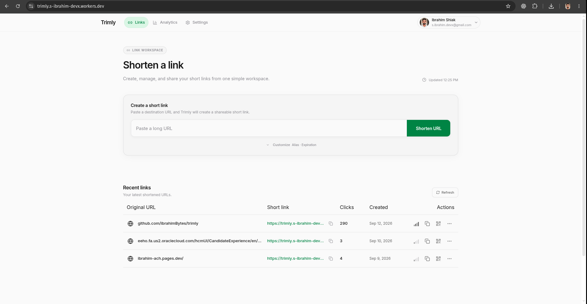
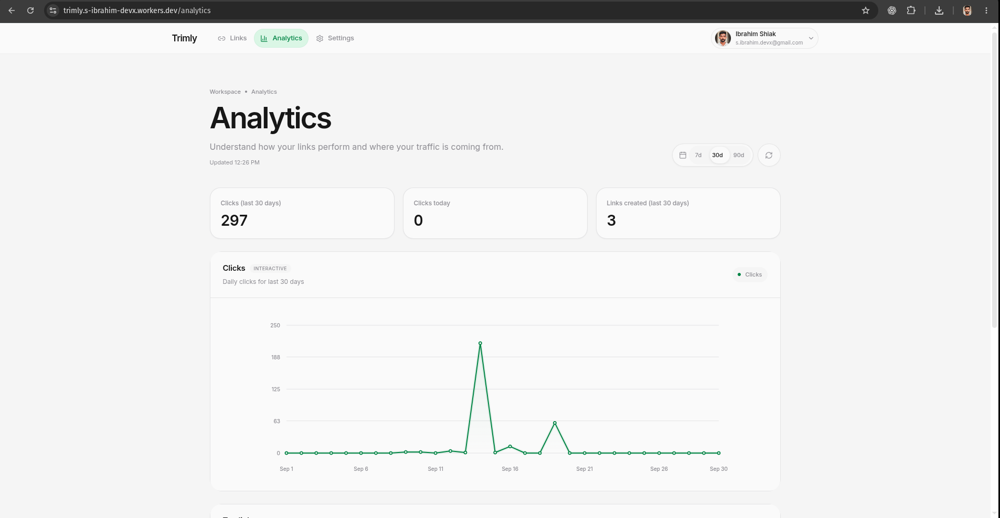

# Trimly

> A production-oriented URL shortener built with **Java 21, Spring Boot, Spring Security, PostgreSQL, Redis, and Apache Kafka**.

**Live Application:** [Open Trimly](https://trimly.s-ibrahim-devx.workers.dev/about)

Trimly is a URL shortening and link analytics platform that transforms long URLs into short, shareable links with custom aliases, expiration, authentication, access control, and click analytics.

The application follows a simple workflow:

**Create → Share → Resolve → Manage → Analyse**

Trimly is a public-source-code project. Its complete application implementation is publicly accessible for inspection, learning, code reviews, and contributions.

---

## Table of Contents

- [Product Preview](#product-preview)
- [Features](#features)
- [Technology Stack](#technology-stack)
- [Architecture](#architecture)
- [Request Flows](#request-flows)
- [Asynchronous Analytics](#asynchronous-analytics)
- [Security and Authentication](#security-and-authentication)
- [Database and Caching](#database-and-caching)
- [REST API](#rest-api)
- [Analytics](#analytics)
- [Performance Engineering](#performance-engineering)
- [Getting Started](#getting-started)
- [Configuration](#configuration)
- [Testing](#testing)
- [Project Structure](#project-structure)
- [Deployment](#deployment)
- [Engineering Decisions](#engineering-decisions)
- [Security Guidelines](#security-guidelines)
- [Contributing](#contributing)
- [License](#license)

---

# Product Preview

### Link Management

Create and manage short links from a focused workspace.

<p align="center">
  
</p>

### Analytics Dashboard

Monitor link activity and analyse click performance over time.

<p align="center">
  
</p>

### Account and Security

Manage account information, authentication, security, and workspace preferences.

<p align="center">
  
</p>

---

# Features

### URL Management

- Short URL generation.
- Custom aliases.
- Link expiration.
- User-owned links.
- Link management.
- URL validation.

### Authentication and Security

- JWT-based authentication.
- Spring Security integration.
- BCrypt password hashing.
- Google Sign-In.
- Two-factor authentication.
- User-scoped resource access.
- Rate limiting.

### Caching and Data Management

- Redis caching for URL resolution.
- PostgreSQL persistent storage.
- Flyway database migrations.
- Database indexing and query optimisation.

### Asynchronous Processing

- Apache Kafka event streaming.
- Asynchronous click analytics.
- Background analytics persistence.
- Graceful degradation when Kafka is unavailable.

### Testing and Engineering

- 35 REST API endpoints.
- 71 passing automated tests across 9 test suites.
- JUnit and Mockito.
- JaCoCo test coverage.
- Maven build automation.
- Docker-based infrastructure.

---

# Technology Stack

| Layer | Technology |
|---|---|
| Programming Language | Java 21 |
| Backend Framework | Spring Boot 4 |
| Security | Spring Security |
| Authentication | JWT |
| Password Hashing | BCrypt |
| ORM | Spring Data JPA / Hibernate |
| Database | PostgreSQL |
| Caching | Redis |
| Event Streaming | Apache Kafka |
| Rate Limiting | Bucket4j |
| Database Migrations | Flyway |
| Testing | JUnit 5, Mockito |
| Code Coverage | JaCoCo |
| Build Tool | Maven |
| Containerisation | Docker, Docker Compose |
| Web Interface | Thymeleaf, HTML, CSS |

---

# Architecture

Trimly uses PostgreSQL as its persistent data store, Redis as its caching layer, and Apache Kafka for asynchronous analytics processing.

```text
                         ┌──────────────┐
                         │    Client    │
                         └──────┬───────┘
                                │
                                ▼
                       ┌──────────────────┐
                       │   Spring Boot    │
                       │       API        │
                       └────┬─────┬────┬──┘
                            │     │    │
               ┌────────────┘     │    └────────────┐
               ▼                  ▼                 ▼
        ┌────────────┐     ┌───────────┐     ┌───────────┐
        │ PostgreSQL │     │   Redis   │     │   Kafka   │
        │   Source   │     │   Cache   │     │ Analytics │
        │  of Truth  │     │           │     │   Events  │
        └────────────┘     └───────────┘     └─────┬─────┘
                                                   │
                                                   ▼
                                           ┌────────────────┐
                                           │ Click Consumer  │
                                           │                │
                                           │ → PostgreSQL   │
                                           └────────────────┘
```

## Component Responsibilities

| Component | Responsibility |
|---|---|
| Spring Boot | REST API and business logic |
| Spring Security | Authentication and access control |
| JWT | Stateless authentication |
| PostgreSQL | Persistent application and analytics data |
| Redis | High-speed URL resolution |
| Apache Kafka | Asynchronous event processing |
| Flyway | Database schema versioning |
| Bucket4j | Request rate limiting |
| Docker | Reproducible infrastructure |

---

# Request Flows

## 1. Create Short URL

```text
Client
  │
  ▼
Spring Boot API
  │
  ├── Validate URL / alias
  │
  ├── Authenticate and authorise
  │
  ├── Persist link
  │       │
  │       ▼
  │   PostgreSQL
  │
  └── Cache link
          │
          ▼
        Redis
```

The application validates the request, verifies the applicable access permissions, persists the URL in PostgreSQL, and populates Redis for subsequent resolution.

## 2. Resolve Short URL

```text
Client
  │
  ▼
GET /{shortCode}
  │
  ▼
Redis
  │
  ├── Cache hit ──────────────► Redirect
  │
  └── Cache miss
          │
          ▼
       PostgreSQL
          │
          ▼
        Redis
          │
          ▼
        Redirect
```

Redis provides a performance layer while PostgreSQL remains the authoritative source of application data.

## 3. Analytics Processing

```text
Short URL Request
       │
       ▼
     Resolve
       │
       ├──────────────► 302 Redirect
       │
       ▼
   Kafka Event
       │
       ▼
Analytics Consumer
       │
       ▼
   PostgreSQL
```

Click analytics are processed asynchronously to separate analytics persistence from URL resolution.

---

# Asynchronous Analytics

One of Trimly's architectural decisions is separating URL resolution from analytics persistence.

### Synchronous Approach

```text
GET /{code}
    │
    ▼
Redis lookup
    │
    ▼
Database INSERT
    │
    ▼
302 Redirect
```

### Kafka-Based Approach

```text
GET /{code}
    │
    ▼
Redis lookup
    │
    ├──────────────► 302 Redirect
    │
    ▼
Kafka publish
    │
    ▼
Background Consumer
    │
    ▼
PostgreSQL
```

The Kafka-based approach separates analytics database writes from the redirect request path.

This reduces direct database pressure on URL resolution and allows analytics persistence to be handled independently.

### Architectural Benefits

- Separation of redirect and analytics workloads.
- Background event processing.
- Independent analytics persistence.
- Better control over database write workloads.
- Improved failure isolation.

---

# Security and Authentication

Trimly uses Spring Security and JWT-based authentication to protect user-specific operations.

### Authentication

- JWT-based authentication.
- Password hashing using BCrypt.
- Google Sign-In.
- Two-factor authentication.
- Protected application endpoints.

### Authorisation

- User-scoped resources.
- Protected link management.
- Access-controlled analytics.
- Separation between public redirects and authenticated management operations.

Public short-link resolution does not require the link owner to authenticate.

Management and analytics operations require appropriate authentication and authorisation.

---

# Database and Caching

## PostgreSQL

PostgreSQL is the source of truth for persistent application state.

It stores:

- Short URLs.
- Destination URLs.
- Expiration information.
- Ownership information.
- Click analytics.
- Other application data.

## Redis

Redis provides high-speed access to frequently resolved URLs.

Caching is used for:

- Short-code to destination URL resolution.
- Long-URL to short-code lookups.
- Rate-limiting state.

A cache miss falls back to PostgreSQL and repopulates the cache.

> Cache for performance. Persist for correctness.

---

# REST API

Trimly implements **35 REST API endpoints** covering application operations, authentication, URL management, and analytics.

The following examples illustrate representative API operations.

## Create Short URL

```http
POST /api/urls
Content-Type: application/json
```

### Example Request

```json
{
  "longUrl": "https://example.com/very/long/path",
  "customAlias": "my-link",
  "expirationTime": "2026-12-31T23:59:59"
}
```

### Request Fields

| Field | Required | Description |
|---|---|---|
| `longUrl` | Yes | Destination URL |
| `customAlias` | No | Custom short code |
| `expirationTime` | No | Expiration timestamp |

### Example Response

```http
201 Created
```

```json
{
  "shortUrl": "http://localhost:8080/api/urls/aB3xYz1",
  "shortCode": "aB3xYz1",
  "longUrl": "https://example.com/very/long/path",
  "expirationTime": "2026-12-31T23:59:59"
}
```

## Resolve Short URL

```http
GET /api/urls/{shortCode}
```

Possible responses:

| Status | Description |
|---|---|
| `302` | Active link |
| `410` | Expired link |
| `404` | Unknown short code |

Each successful redirect also produces an analytics event.

**Note:** These are representative endpoint examples, not the complete API specification.

---

# Analytics

Trimly processes click events through Apache Kafka and persists analytics data in PostgreSQL.

Analytics can include:

- Click counts.
- Activity over time.
- IP information.
- User-agent information.
- Link-specific statistics.

The analytics processing architecture separates event generation from database persistence.

---

# Performance Engineering

Trimly uses Redis caching and Kafka-based asynchronous processing to improve the efficiency of URL resolution and analytics ingestion.

### Performance Objectives

- Minimise redirect latency.
- Reduce unnecessary database reads.
- Separate analytics writes from redirect processing.
- Control database write workloads.
- Maintain efficient resource utilisation.

Performance improvements should be evaluated using reproducible benchmarks rather than assumptions.

Relevant metrics include:

- Minimum response time.
- Mean response time.
- P50 latency.
- P95 latency.
- P99 latency.
- Throughput.
- Error rate.

---

# Getting Started

## Prerequisites

Install:

- Java 21+
- Maven 3+
- Docker
- Docker Compose

## 1. Clone the Repository

```bash
git clone <YOUR_PUBLIC_REPOSITORY_URL>
cd <YOUR_REPOSITORY_DIRECTORY>
```

Replace the placeholders with your actual GitHub repository URL and directory.

## 2. Start Infrastructure

```bash
docker-compose up -d
```

Expected local services:

```text
PostgreSQL → localhost:5431
Redis      → localhost:6379
Kafka      → localhost:9092
```

## 3. Configure Environment Variables

Configure the environment variables required by the application.

Never commit production credentials or local secret files.

## 4. Start the Application

```bash
./mvnw spring-boot:run
```

Flyway automatically applies database migrations during startup.

The application becomes available at:

```text
http://localhost:8080
```

## 5. Stop Infrastructure

```bash
docker-compose down
```

---

# Configuration

Application configuration is defined in:

```text
src/main/resources/application.yaml
```

### Configuration Reference

| Property | Default |
|---|---|
| Server port | `8080` |
| PostgreSQL | `localhost:5431` |
| Redis | `localhost:6379` |
| Kafka | `localhost:9092` |
| Kafka consumer group | `analytics-consumer-group` |
| Rate limit | `20 requests/minute/IP` |
| Cleanup schedule | Hourly |

### Environment Variables

Previously documented environment overrides include:

```text
KAFKA_SERVERS
APP_BASE_URL
RATE_LIMIT
```

Additional configuration may be required for JWT, database connections, and external authentication providers.

Consult the application configuration for the complete list.

---

# Testing

Trimly has a documented automated test suite containing:

<details>
<summary><strong>Test Metrics</strong></summary>

| Metric | Result |
|---|---:|
| REST API endpoints | 35 |
| Passing automated tests | 71 |
| Test suites | 9 |
| Test framework | JUnit 5 |
| Mocking framework | Mockito |
| Coverage tool | JaCoCo |

</details>

The test suite validates application behaviour across multiple components.

Testing areas include:

- REST API functionality.
- URL generation and management.
- Authentication and access control.
- Redis caching.
- Analytics processing.
- Kafka event handling.
- Database operations.
- Expiration and cleanup.
- Request validation and error handling.

### Run Tests

```bash
./mvnw clean verify
```

This executes the Maven verification lifecycle, including configured tests and coverage checks.

---

# Project Structure

```text
src/main/java/com/example/URLShortener/
├── UrlShortenerApplication.java
│
├── config/
│   ├── KafkaConfig.java
│   ├── RateLimitFilter.java
│   └── FilterConfig.java
│
├── controllers/
│   ├── urlController.java
│   └── WebController.java
│
├── dto/
│   ├── URLRequest.java
│   ├── URLResponse.java
│   ├── AnalyticsResponse.java
│   └── ClickEventMessage.java
│
├── models/
│   ├── URL.java
│   └── ClickEvent.java
│
├── repository/
│   ├── UrlRepository.java
│   └── ClickEventRepository.java
│
└── services/
    ├── UrlService.java
    ├── AnalyticsService.java
    ├── ClickEventConsumer.java
    ├── CleanupService.java
    └── Base62Encoder.java

src/main/resources/
├── application.yaml
├── db/
│   └── migration/
└── templates/
    ├── index.html
    └── analytics.html
```

---

# Deployment

Trimly follows a containerised cloud deployment model.

```text
                  Cloud Environment

              ┌────────────────────┐
              │  Spring Boot App   │
              │     Container      │
              └───────┬────────────┘
                      │
           ┌──────────┼──────────┐
           ▼          ▼          ▼
       PostgreSQL   Redis      Kafka
        Managed    Managed    Managed
```

### Deployment Principles

- Containerised application runtime.
- Managed PostgreSQL.
- Managed Redis.
- Managed Kafka.
- Environment-based configuration.
- Automated database migrations.
- Health checks.
- Externalised secrets.
- Reproducible deployment.

---

# Engineering Decisions

### 1. PostgreSQL as the Source of Truth

Redis improves lookup performance but does not replace durable persistence.

### 2. Redis for Frequently Accessed Data

Short-link resolution is a frequent operation, making caching an effective performance optimisation.

### 3. Kafka for Analytics Processing

Analytics persistence is separated from the redirect path through asynchronous event processing.

### 4. JWT for Authentication

JWT-based authentication allows protected application operations to verify user identity through signed tokens.

### 5. Public Resolution and Private Ownership

Short links are publicly resolvable while management operations remain protected by authentication and authorisation.

### 6. Flyway for Schema Management

Database changes are version-controlled and applied through migrations.

### 7. Rate Limiting for Request Control

Bucket4j limits requests to reduce excessive traffic against the application.

### 8. Scheduled Expiration Cleanup

Expired URLs are removed from persistent storage and the cache through scheduled cleanup.

---

# Security Guidelines

Trimly is a public-source-code project. Its application implementation is publicly accessible.

However, public source-code availability does not mean production credentials should be public.

Never commit:

- Database passwords.
- JWT signing secrets.
- OAuth client secrets.
- API keys.
- Redis credentials.
- Kafka credentials.
- Private keys.
- Production environment files.
- Personal access tokens.

### Security Practices

- Use environment variables for sensitive configuration.
- Maintain an appropriate `.gitignore`.
- Use secure deployment environment configuration.
- Rotate credentials if accidentally exposed.
- Review Git history for previously committed secrets.
- Avoid exposing sensitive user information in application logs.

---

# Contributing

Contributions and constructive feedback are welcome.

### Contribution Workflow

1. Fork the repository.
2. Create a feature branch.
3. Implement your changes.
4. Add or update relevant tests.
5. Run the verification suite.
6. Submit a pull request explaining your changes.

### Contribution Guidelines

- Follow existing coding conventions.
- Prefer maintainable implementations.
- Avoid unnecessary dependencies.
- Include tests for new functionality.
- Preserve existing API contracts unless changes are intentional.
- Never commit secrets or private credentials.
- Document significant architectural changes.

---

# Live Product

**[Open Trimly](https://trimly.s-ibrahim-devx.workers.dev/about)**

Trimly is live and under active development, with continued work focused on reliability, security, performance, and product improvements.

---

# Repository Scope

Trimly is a public-source-code project.

The repository provides access to:

- Complete application source code.
- Backend implementation.
- Frontend implementation.
- Database migrations.
- Application configuration templates.
- Infrastructure configuration.
- Automated tests.
- Architecture documentation.
- API documentation.
- Engineering decisions.

The project is intended to support transparency, technical learning, collaboration, code reviews, and continued engineering improvements.

---

# License

This project is licensed under the **MIT License**.

See the [LICENSE](LICENSE) file for details.

---

<p align="center">

**Trimly — Shorten links. Understand engagement. Build better.**

Built with Java 21, Spring Boot, PostgreSQL, Redis, and Apache Kafka.

</p> 
